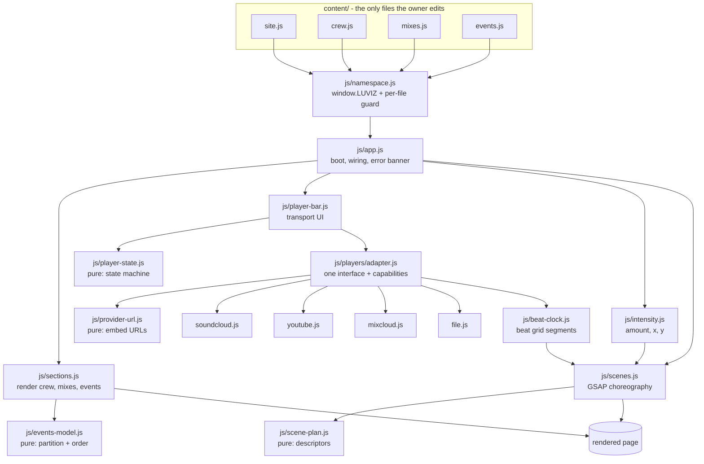
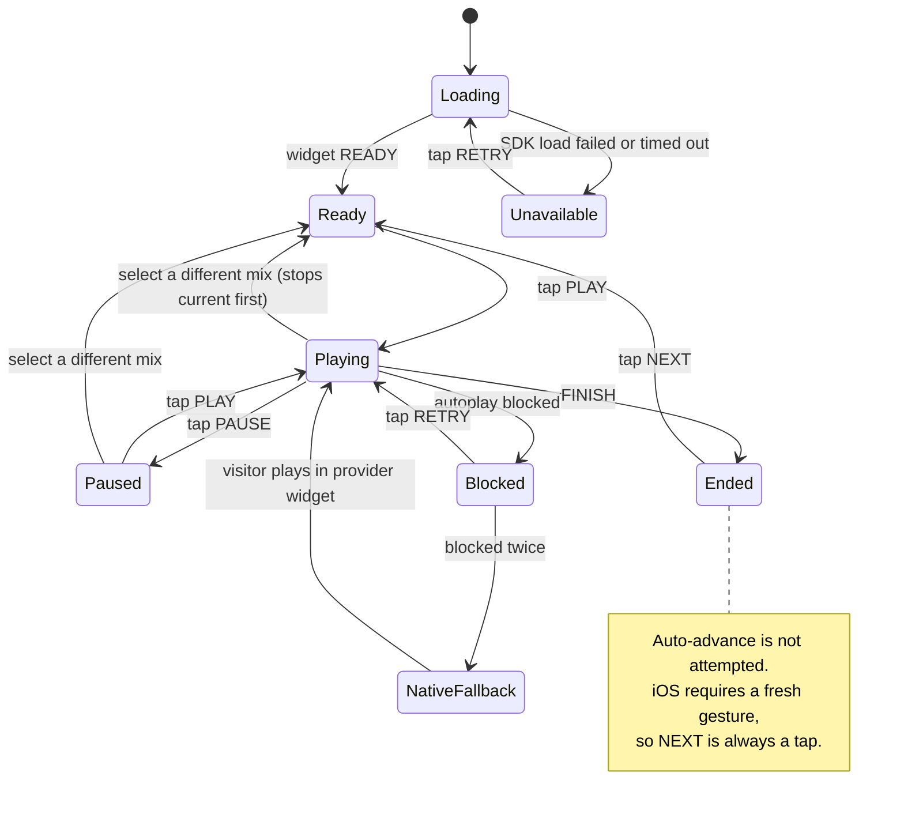

# LUVIZMUSIC Site - Plan

## Goal Capsule

**Objective.** Ship a single-page, zero-build, GSAP-driven website for the LUVIZMUSIC music night: crew bios, mixes, and events, with a persistent player that keeps a mix running while the visitor scrolls.

**Authority hierarchy.** Requirements (R-IDs) win on product behavior. Key Technical Decisions (KTD-IDs) win on implementation mechanism within their cited R constraints. Units override neither.

**Execution profile.** Greenfield static site. No package manager, no bundler, no install step. Agent verification is `node --test` from the repo root (Node 24 built-in runner, already present). Browser, device, and human checks are owner-verifiable and listed separately — see the Verification Contract's two tables.

**Stop conditions.** Stop and surface a blocker if U0's iOS activation spike fails and the owner has not chosen a fallback, or if a provider API returns a shape that contradicts KTD4's adapter contract. Do not silently substitute a different playback model.

**Tail ownership.** The caller owns commit and handoff. This repo has no git remote, so there is no push, PR, or CI.

---

## Product Contract

### Summary

Build `index.html` plus supporting CSS, JS, and content files that render the LUVIZMUSIC identity as one long scroll: hero, crew, mixes, events, contact. A persistent player bar plays mixes hosted on SoundCloud, YouTube, Mixcloud, or self-hosted files through the site's own transport controls. Motion is choreographed with GSAP and pulses on a per-mix beat grid. All owner-editable content lives in `content/`.

### Problem Frame

The crew has no web presence. Prospective attendees cannot find who plays, hear prior mixes, or learn when the next party is. Existing link-in-bio and platform pages scatter that across three services, so the night has no single address that describes it in its own voice.

The site gives the night one address, one continuous listening session, and one place it is described. Playback itself stays hosted by the platforms, and their required attribution and player chrome stay visible — R13 and R14 make that explicit. The gain is a single self-branded surface around the music, not removal of the platforms.

The owner does not write code and will maintain the site himself between parties. Any solution that needs a toolchain to publish a new event date will stop being updated, and any solution where a mistyped character silently blanks the site will lose his trust the first time it happens.

### Requirements

**Brand and visual identity**

- R1. Display type is FF Mark Pro Italic; body type is upright Mark Pro; both are self-hosted.
- R2. The palette ships two red tokens: a bright red meeting WCAG AA (4.5:1) for text on the near-black ground, and a deep red meeting AA on bone-white panels.
- R3. Texture reads as print and darkroom artefact (grain, misregistration, posterisation, duotone), not as neon glow.
- R4. A fixed, never-degraded LUVIZMUSIC mark and section navigation sit over the degrading decorative field.
- R5a. Third-party player chrome and required attribution are composed into the design as a deliberate framed element, not left as unstyled foreign UI.

**Content and structure**

- R5. One page presents hero, crew, mixes, events, and contact, each deep-linkable by anchor.
- R6. All owner-editable content lives under `content/`, and publishing new content requires editing no file outside that directory.
- R7. Each mix declares its own provider and plays through the site's transport controls. On iOS, R7 applies from the first successful play onward; see R12a.
- R8. Events separate upcoming from past, ordering upcoming soonest-first.
- R9. Content files ship populated with placeholder crew, mixes, and events that demonstrate every supported field.
- R9a. A malformed content file degrades to a named, human-readable on-page error and does not prevent the other sections from rendering.

**Playback**

- R10. A persistent player bar is reachable from every section and continues playing across the whole page.
- R11. Playback starts from the visitor's own tap or click on the site's transport control.
- R12. When a provider blocks or fails playback, the player surfaces a retry affordance rather than failing silently.
- R12a. When playback is blocked twice in succession, the player escalates to a provider-native first-play fallback rather than re-offering the same control.
- R13. YouTube-hosted mixes play in a visible, unobstructed player of at least 200x200 CSS pixels.
- R14. SoundCloud playback carries the required attribution: uploader credit, SoundCloud logo, and a link to the source URL.
- R15a. The player exposes elapsed and total time, and a seek control whose interactive state reflects the provider's declared capability without changing the bar's geometry.

**Motion and interaction**

- R15. Scroll-driven motion is choreographed with GSAP and never delays legibility of text.
- R16. Visuals pulse on a per-mix beat grid supplied with the mix, staying in phase for the duration of each declared tempo segment. A mix with no beat grid does not pulse.
- R17. Every pointer-driven effect has a touch equivalent driven by the same signal, and no effect reads an input device directly.

**Responsiveness and accessibility**

- R18. The site is art-directed and usable from 320px to ultrawide, with no horizontal overflow of the page body.
- R19. Under `prefers-reduced-motion: reduce`, no scroll-scrubbed or looping motion is created, and all content renders in its final state.
- R20. Nothing flashes more than three times per second, no full-viewport red flash occurs, and no repeating effect changes large-area relative luminance by more than 10% between frames.
- R21. Every interactive control is keyboard reachable with a visible focus indicator that is never occluded by fixed chrome, and player state changes are announced to assistive technology.
- R22. All statically authored text (headings, section copy, navigation, contact details) is present and readable with JavaScript disabled, and each content-driven list carries a `noscript` fallback naming what requires JavaScript.

**Delivery**

- R23. The site runs from any static file server with no build step and no install.
- R24. Opening `index.html` directly from disk renders layout, type, texture, and all authored text. Provider playback requires an HTTP origin and is out of scope for the file-protocol path.
- R25. Total web font payload stays under 100KB.

### Scope Boundaries

**Deferred to follow-up work**

- Real crew names, bios, photos, mix URLs, and event dates. The owner supplies these into `content/`.
- Genuine FFT-driven visuals for embed-hosted mixes. Impossible per KTD3; available only on the self-hosted path (KTD14) and not built in this pass.
- Ticketing, mailing list capture, or any server-side component.
- A CMS or admin UI.
- Offline support or a service worker.

**Outside this product's identity**

- Multi-page navigation with route transitions. R5 fixes the single-scroll shape.
- Any glow, bloom, neon, or particle-field treatment. R3 fixes the print-artefact vocabulary.
- A separate simplified mobile design. R17 and R18 require one design language that adapts.

### Open Questions

- Deferred: "Raph Doug" in the owner's reference list is most likely **Ruf Dug** (Manchester, Ruf Kutz label), at roughly 80% confidence; no artist by the literal spelling exists on Discogs, RA, or SoundCloud. Affects tone only. Build to the Ruf Dug reading; the owner confirms later.
- Deferred: whether the crew holds its own audio files for any mix. If yes, KTD14's self-hosted path removes both the activation relay and the beat-grid burden for those mixes.
- Deferred: who runs U0's iOS device check, on what hardware and iOS version. The plan names it the largest risk; the owner names the tester.

---

## Planning Contract

### Key Technical Decisions

- KTD1. **Classic scripts and a `window.LUVIZ` namespace; content ships as `.js`, never `.json`.** (session-settled: user-approved — chosen over an Astro or Next.js build pipeline: the owner is not a coder and wants nothing that rots between parties. Governs R6, R23, R24.) Verified across Chrome 150, Edge 151, and Firefox 152: over `file://`, external module scripts, relative module imports, `fetch()`, XHR, and dynamic `import()` all fail with `CORS request not HTTP`, while classic external scripts work. JSON content would make R24 impossible.

- KTD2. **GSAP 3.15.0 pinned from jsDelivr with SRI: core, ScrollTrigger, SplitText, and Observer. No ScrollSmoother.** (session-settled: user-approved — chosen over a multi-page build with route transitions: a persistent player must never survive a page load. Governs R5, R15.) Since 3.13 every plugin is free for commercial use with no token. Each plugin earns its place: ScrollTrigger drives the scenes, SplitText drives per-line display reveals (U8's `hero-wordmark-bleed` and `crew-name-cascade`), Observer normalises pointer, touch, wheel, and scroll into the one intensity signal (U7). ScrollSmoother is rejected because its wrapper transform creates a containing block that breaks `position: fixed` for the player bar and nav, and because smooth-scroll hijacking measurably disorients users.

- KTD3. **Reactivity comes from a per-mix beat grid, not frequency analysis.** (session-settled: user-approved — chosen over an auto-arming entry splash and a second muted ambient audio system: browsers block unmuted autoplay and one honest audio system beats two half-working ones. Governs R11, R16.) **Conflict call-out:** the settled decision anticipated audio-reactive visuals "where technically possible", and research established true FFT analysis of an embed is impossible behind three independent walls — the media element is unreachable cross-origin, the Web Audio spec mandates that a `MediaElementAudioSourceNode` output silence for CORS-cross-origin resources, and `captureStream()` does not exist on `HTMLIFrameElement`. Suboptimal-but-workable, not invalidating: the persistent player is fully feasible and beat alignment is what listeners perceive. A single scalar BPM is insufficient — a DJ mix is several tracks at different tempos, and at 124 BPM a 0.1 BPM error accumulates half a beat of phase error in about five minutes. Each mix therefore declares `beatGrid: [{ atMs, bpm }]`; the clock recomputes phase from the segment containing the current position. A one-entry grid is the constant-tempo case; an absent grid disables pulsing rather than pulsing wrongly.

- KTD4. **One player adapter interface over four providers, with runtime-probed capability flags.** (Governs R7, R12, R15a.) The three embed APIs differ in shape: SoundCloud getters are callback-based, Mixcloud getters return promises, YouTube getters are synchronous. Mixcloud can refuse `seek()` for licensing reasons and may expose no volume setter. Capabilities are probed at runtime against a stated default rather than hard-coded from an unresolved belief, so a wrong assumption degrades one control instead of shipping a green test suite next to a broken player.

- KTD5. **YouTube renders in a visible expanding drawer; SoundCloud and Mixcloud clip to a compact strip. All provider chrome sits inside a designed frame.** (Governs R13, R5a.) YouTube's Developer Policies prohibit, verbatim, playing content "from a background player, meaning a player that is not displayed in the page, tab, or screen that the user is viewing", and set a 200x200 minimum viewport. Hiding it is a policy breach, not a technical trick. Because foreign chrome is therefore permanent and unstyleable, U6 gives it a deliberate housing in the H5 retail grammar (ruled, labelled panel) rather than leaving it to look like a mistake. All iframes stay in the render tree — never `display: none` — because browsers deprioritise unrendered iframes and a Permissions Policy to pause their media is in flight.

- KTD6. **Grain is a pre-rendered `feTurbulence` data URI stepped by transform; misregistration is duplicated elements with blend modes. No SVG filter animates.** (session-settled: user-approved — chosen over a disciplined conventional treatment: the owner asked for out-there and intricate. Governs R3, R15, R20.) The GSAP team's position on live SVG filters is that they are "pretty horrific for performance" and "100% a no-go" for sustained or wide-area animation. Rendering turbulence once to a data URI and animating an oversized overlay with `steps()` costs a compositor transform. The grain steps at 8-12Hz but each step's large-area luminance delta stays under R20's 10% bound, so it is texture movement rather than a flash; the three-per-second cap governs any effect that does cross that threshold.

- KTD7. **Five self-hosted Mark Pro faces, one family, subset to Latin plus European name characters.** (session-settled: user-directed — chosen over a free geometric-italic lookalike: the owner supplied the licensed files and wants the exact brand typeface. Governs R1, R25.) Faces: Hairline 250, Regular 400, Bold 700 upright, plus Medium Italic 500 and Heavy Italic 800. Mark OT is excluded: measured coverage is 419 codepoints against Mark Pro's 629, carrying only 13 of 128 Latin Extended-A, so a Polish, Czech, Turkish, or Romanian crew name set in an OT face would fall back to a system font at the loudest typographic moment. Mark Pro Heavy Italic (629 codepoints, italicAngle -12, weight 800) is the display voice instead; there is no Mark Pro 900 italic and none is needed, because Hairline 250 against Heavy Italic 800 already gives the extreme contrast the design wants.

  **The subset range must preserve that rationale.** A Latin-only subset drops all of Latin Extended-A and reproduces exactly the fallback this decision rejected Mark OT to avoid. Measured on the real build: Latin-only 78,784 bytes / 236 codepoints; Latin plus Polish, Czech, Slovak, Hungarian, Turkish, and Romanian characters 89,876 / 297; all of Latin Extended-A 99,992 / 361; Extended-A and -B 105,408 / 398. Ship the second: it is the only variant that both clears R25 with real headroom and delivers what the face set was chosen for. Full Extended-A fits by 8 bytes, which is not a budget.

  Layout features are `kern, calt, locl, case, cpsp, tnum` — tabular figures earn their 1,736 bytes on dates and tracklists. `--layout-features='*'` measures 163,716 bytes on this family, a 2.1x blowup.

- KTD8. **Source OTFs are gitignored; only generated WOFF2 files are committed, alongside the converter script.** (Governs R25.) The site must serve the WOFF2s, so those are committed. The multi-megabyte source OTFs are not served and need not be tracked; `tools/build-fonts.py` regenerates the web faces from the owner's local copy. Name IDs 7, 8, 9, and 14 (trademark, designer, foundry, licence URL) are preserved in every output as correct practice for a licensed face; name ID 13 is absent from these particular source files.

- KTD9. **Two red tokens, not one.** (session-settled: user-approved — chosen over red plus an acid secondary, red on bone, or per-section palette flips: nothing should dilute the red. Governs R2.) Computed contrast forces this. Against `#0A0A0A`, `#FF1A1A` scores 5.105 and clears AA for body text, while `#C1121F` scores 3.172 and is display-only. Inverted, the ordering reverses: bright red on bone white fails at roughly 3.2-3.5, while `#C1121F` on bone scores 5.52. One token cannot serve both grounds.

- KTD10. **Touch parity via one shared intensity signal shaped `{ amount, x, y }`.** (Governs R17.) A scalar cannot express direction, so a pointer parallax would have no legal source and an implementer would read `pointermove` directly — the exact silent R17 break the contract exists to prevent. `amount` is 0-1 energy; `x` and `y` are -1..1 direction. On `(pointer: fine)` devices, `amount` derives from pointer velocity and `x`/`y` from pointer position relative to viewport centre. On touch, `amount` derives from scroll velocity, `y` from signed scroll direction, and `x` is 0. Both classes decay `amount` toward 0 at rest while holding last `x`/`y`, so the two modes rest identically. GSAP's Observer supplies the normalised input.

- KTD11. **Zero-install local preview via `PREVIEW-SITE.bat` wrapping PowerShell `HttpListener`.** (Governs R23, R24.) Windows PowerShell 5.1 and .NET Framework ship with Windows 11, so this binds a localhost port without admin rights and without installing anything. Verified working on the owner's machine. It is also the required path for any playback check, because provider handshakes need an HTTP origin.

- KTD12. **No `content-visibility: auto` on any section carrying a ScrollTrigger, and no `backdrop-filter` on fixed chrome.** (Governs R15, R18.) GSAP's docs state that `content-visibility: auto` behaves like `display: none` for measurement, making trigger positions uncomputable; a filed issue records it breaking pinning from a sibling element. Separately, `backdrop-filter` on a `position: fixed` element repaints the blurred region every scroll frame and is a known severe jank source on iOS Safari.

- KTD13. **The hero wordmark is inline SVG text with a `viewBox`.** (Governs R18.) Geometric scaling cannot overflow at 320px, and it lets display type bleed deliberately past the viewport edges on phones, which reads as more dramatic than desktop rather than timid.

- KTD14. **Embed-hosted playback is the default, with a fourth `file` provider for self-hosted mixes.** (Governs R7, R16.) Embeds are the default because they carry platform reach and discovery, cost no hosting or bandwidth, and keep takedown exposure off the crew's own server. That choice is what makes FFT impossible, forces the activation relay, and imposes the beat grid — so the adapter seam KTD4 already provides also carries a `file` provider backed by an `HTMLAudioElement`. It needs no cross-iframe relay, works same-origin, and can drive a real `AnalyserNode` later. Any mix the crew hosts itself escapes both the relay risk and the beat-grid burden.

- KTD15. **Pure logic lives in DOM-free modules; DOM work lives in thin browser-only layers.** (Governs the Verification Contract.) Node has no `document` and no `matchMedia`, and the no-install rule rules out jsdom. Every unit with automated tests therefore names a separate pure module — `js/events-model.js`, `js/player-state.js`, `js/provider-url.js`, `js/scene-plan.js`, `js/marquee-model.js`, `js/pointer-mode.js` — and its DOM counterpart is verified in-browser instead.

### High-Level Technical Design

Component topology and data flow. Content files are the only owner-editable surface; `js/app.js` is the boot hub that wires everything.



First-play gesture. The synchronous path from tap to audio is the design's hardest constraint, and its failure branch is architectural rather than cosmetic.

```mermaid
sequenceDiagram
  participant U as Visitor
  participant B as Player bar
  participant A as Adapter
  participant W as Provider widget
  participant K as Beat clock
  participant S as Scenes

  Note over B,W: iframe pre-created with allow="autoplay"; widget READY already fired; button disabled until then
  U->>B: tap PLAY
  B->>A: play() - synchronous, no await before this
  A->>W: widget.play()
  alt playback starts
    W-->>A: PLAY event
    A->>K: start(beatGrid)
    K-->>S: beat boundary events
    S-->>B: transport reflects playing state
  else blocked, first time
    W-->>A: onAutoplayBlocked / NotAllowedError
    A-->>B: blocked
    B->>U: retry affordance (R12)
  else blocked, second time
    A-->>B: blocked again
    B->>U: reveal provider-native control (R12a)
    Note over U,W: visitor taps inside the provider widget once;<br/>site transport resumes control afterward
  end
```

Player lifecycle. Loading and Unavailable are first-class so a slow or blocked CDN never reads as a dead button.



### Assumptions

- The owner previews locally on Windows 11, where PowerShell 5.1 and .NET Framework are present. KTD11 depends on this.
- Node 24 is available for `node --test`. Development-time only; the shipped site has no Node dependency.
- Placeholder crew, mix, and event content is fictional and clearly marked, so no real person or venue is misrepresented before the owner substitutes real data.
- Placeholder mixes reference publicly embeddable tracks purely to exercise each provider path. Any can be deleted or geo-blocked by its uploader, which would fail a playback check for reasons unrelated to the code; U10 tells the owner how to tell the difference.

### System-Wide Impact

- **Structural, from day one.** Every `position: fixed` element — the nav and mark, the player bar, the custom cursor, the grain overlay, and the skip links — is a direct child of `body`, outside any transformed ancestor.
- **Fixed chrome reserves space.** Nav and player-bar heights are exposed as CSS custom properties and applied as `scroll-padding` on the scroll container, `scroll-margin` on anchor targets and focusable cards, and `padding-bottom` on `body`. Without this, anchor jumps land headings under the nav and the `focusin` handler parks focus behind the player bar.
- **Font loading invalidates every scroll position.** `font-display: swap` reflows text after first paint, moving every ScrollTrigger start and end. `document.fonts.ready` must trigger `ScrollTrigger.refresh()` and then re-resolve `location.hash`.
- **The intensity signal (KTD10) is a cross-cutting contract.** Every motion consumer reads it. A second input path for any one effect breaks R17 silently.
- **Beat and intensity must not write the same property on the same element.** Beat drives discrete pulses (scale kick, misregistration offset); intensity drives continuous parallax and warp. U8's scene inventory assigns each scene one driver.

### Risks and Dependencies

- **iOS relayed activation is the largest unverified assumption, and retry does not mitigate it.** WebKit requires that the JS calling `play()` "directly resulted from a handler for a `touchend`, `click`, `doubleclick`, or `keydown` event", and the adapter relays across an iframe boundary. If activation does not propagate structurally, a retry tap runs the identical path and fails identically, forever. The real fallback is architectural: R12a's provider-native first play, after which the site transport resumes control. U0 tests this before any other unit is built, so the discovery cannot land after the visual system is choreographed around a broken player.
- **A green adapter suite does not prove the providers work.** U5's tests run against stubs written from the same reading of the same docs; a wrong belief produces a matching stub and a passing test. Runtime capability probing (KTD4) plus the owner-verifiable live smoke check are what actually prove conformance.
- **Provider APIs are third-party and unpinned.** All three were verified live with no deprecation notices, but their widget scripts load from provider CDNs by necessity. The adapter boundary confines the blast radius to one file per provider.
- **Three provider iframes in the render tree means third-party players and cookies load before any audio is requested.** U6 creates a provider's iframe lazily on first selection of a mix using that provider, not at boot.
- **Font licence (open question) could force substitution.** The face set is referenced through CSS custom properties and one `@font-face` block, so substitution is a single-file change.

---

## Implementation Units

### Unit Index

| U-ID | Title | Key files | Depends on |
|---|---|---|---|
| U0 | iOS activation spike | `spike/ios-activation.html` | - (runs first) |
| U1 | Repo skeleton, content model, resilience, preview | `index.html`, `content/*.js`, `js/namespace.js`, `PREVIEW-SITE.bat`, `CHECK-CONTENT.bat`, `.gitignore` | - |
| U2 | Font pipeline and type scale | `tools/build-fonts.py`, `assets/fonts/*.woff2`, `css/type.css` | U1 |
| U3 | Visual system: palette, grain, print artefacts | `css/tokens.css`, `css/texture.css` | U1 |
| U4 | Page shell, nav, sections, boot, accessibility floor | `index.html`, `js/app.js`, `js/sections.js`, `js/events-model.js`, `css/base.css`, `css/sections.css` | U1, U2, U3 |
| U5 | Provider-agnostic player adapter | `js/players/*.js`, `js/provider-url.js` | U1 |
| U6 | Persistent player bar and first-play gesture | `js/player-bar.js`, `js/player-state.js`, `css/player.css` | U0, U4, U5 |
| U7 | Beat clock and intensity signal | `js/beat-clock.js`, `js/intensity.js` | U5 |
| U8 | GSAP scroll choreography | `js/scene-plan.js`, `js/scenes.js`, `css/motion.css` | U4, U7 |
| U9 | Section interactions | `js/cursor.js`, `js/marquee.js`, `js/marquee-model.js`, `js/pointer-mode.js`, `js/section-fx.js`, `css/section-fx.css` | U4, U7, U8 |
| U10 | Owner handbook and content-swap guide | `README.md`, `content/README.md` | U0-U9 |

### U0. iOS activation spike

**Goal:** Prove or disprove relayed first-play on a real iOS device before anything is built on top of it.

**Requirements:** R11, R12a. De-risks KTD4 and KTD5.

**Dependencies:** none. This unit runs first.

**Files:** `spike/ios-activation.html`

**Approach:**
1. Build one static page: three iframes (SoundCloud, YouTube, Mixcloud), each with `allow="autoplay"`, and one button per provider that calls the widget's `play()` synchronously inside the tap handler.
2. Serve it over HTTP via `PREVIEW-SITE.bat` or any host. It cannot be tested over `file://` (see R24).
3. Record, per provider: did audio start from the site's own button, and did a second tap after a block succeed?
4. If relayed activation fails for a provider, record that provider as requiring R12a's native-fallback path from the outset.

**Execution note:** This is a throwaway spike, kept in the repo as evidence. It is not wired into the site.

**Test scenarios:** Test expectation: none — this unit's entire output is a recorded device observation, which no automated gate can produce.

**Verification (owner-verifiable):** On a real iPhone, each provider either plays from the site's button, or is recorded as needing the native-fallback path. The result is written into `README.md`.

### U1. Repo skeleton, content model, resilience, and preview

**Goal:** Establish the file layout, the `window.LUVIZ` content contract, content-error resilience, and a preview path that works by double-click and by local server.

**Requirements:** R6, R9, R9a, R23, R24. Instantiates KTD1 and KTD11.

**Dependencies:** none.

**Files:**
- `index.html` (skeleton: script order, pinned GSAP tags with SRI and `crossorigin`)
- `js/namespace.js`
- `content/site.js`, `content/crew.js`, `content/mixes.js`, `content/events.js`
- `PREVIEW-SITE.bat`, `CHECK-CONTENT.bat`
- `.gitignore`
- `tests/content.test.js`

**Approach:**
1. Write `.gitignore` excluding `FF Mark Pro/` per KTD8, plus OS and editor noise.
2. Define the content schema on `window.LUVIZ`:
   - `site`: `tagline`, `blurb`, `contactEmail`, `socialLinks`, consumed by the hero and contact sections.
   - Each mix: `title`, `provider` (`soundcloud` | `youtube` | `mixcloud` | `file`), `url`, optional `beatGrid` (array of `{ atMs, bpm }`), optional `artwork` and `credit`.
   - Each crew member: `name`, `alias`, `bio`, `photo`, `links`.
   - Each event: `title`, `date` (ISO), `venue`, `city`, optional `ticketUrl`.
3. Put the GSAP script tags in `index.html` here, since this unit owns script order. U8 owns registration and scene construction, not loading.
4. Populate all four content files with placeholder data covering every field and all four providers. Mark placeholders clearly in comments.
5. Comment each content file for a non-coder: what to change, what not to touch, what a trailing comma does.
6. `js/namespace.js` initialises `window.LUVIZ` and records which content files loaded successfully, so a file that failed to parse is detectable by absence rather than by an exception.
7. Write `PREVIEW-SITE.bat` wrapping a PowerShell `HttpListener` bound to localhost, launching the browser at that address.
8. Write `CHECK-CONTENT.bat`: loads the four content files and prints PASS, or the first syntax error with its file and line, in the same zero-install spirit as KTD11.

**Test scenarios** (`tests/content.test.js`, run under `node --test` with `globalThis.window = globalThis` shimmed):
- Loading each content file defines its expected `window.LUVIZ` key.
- Every mix declares a `provider` in the supported set.
- A mix with a `beatGrid` has entries with non-negative `atMs` and `bpm` within 60-200, ordered by `atMs`.
- A mix with no `beatGrid` validates successfully and is marked non-pulsing.
- Every event `date` parses as a valid ISO date.
- Event fixtures are constructed relative to the current date, so the suite cannot go red when a hardcoded future date passes.
- Every crew member has a non-empty `name` and `bio`.
- `site` carries a non-empty `tagline` and `contactEmail`.
- A content file containing a deliberate syntax error yields a named, human-readable failure rather than an undefined key.

**Verification:** `node --test` passes from the repo root. Double-clicking `index.html` produces a page whose console shows the populated `window.LUVIZ` with no CORS errors. `PREVIEW-SITE.bat` serves the same page over localhost. `CHECK-CONTENT.bat` reports PASS, and reports the file and line after a deliberate corruption.

### U2. Font pipeline and type scale

**Goal:** Convert the licensed OTFs to Latin-subset WOFF2 and express the typographic system.

**Requirements:** R1, R25. Instantiates KTD7 and KTD8.

**Dependencies:** U1.

**Files:**
- `tools/build-fonts.py`
- `assets/fonts/` (5 generated `.woff2` files)
- `css/type.css`
- `tests/fontbudget.test.js`

**Approach:**
1. Map the five source faces to output names, all from Mark Pro: `Hairline.otf` (250), `FF.Mark.Pro.otf` (400), `Bold.otf` (700), `Medium.Italic.otf` (500 italic), `Heavy.Italic.otf` (800 italic). Mark OT is not used.
2. Subset with `pyftsubset` to **Latin only**, passing `--name-IDs+=7,8,9,13,14` so the trademark and licence URL survive. Measured total: 76,644 bytes. Latin-Extended would total 105,020 and bust R25.
3. Omit `--layout-features='*'`, which more than doubles output on this family; request only the features the design uses. Skip `--desubroutinize`, a verified no-op here.
4. Set `recalcTimestamp=False` so output is byte-reproducible.
5. Do not convert CFF outlines to TrueType. It is a lossy refit of a licensed display face with no measured size benefit.
6. Write `@font-face` blocks in `css/type.css` with `font-display: swap`, and preload at most the two above-the-fold faces with `crossorigin` — mandatory even same-origin, or the font downloads twice.
7. Build the type scale on `clamp()`, always retaining a `rem` term so browser zoom is not defeated. Assign italic to voice (crew names, mix titles, slogans) and upright to information (dates, nav, tracklists).
8. If the combined budget ever fails, the resolution order is fixed: drop the Hairline face first, then the Medium Italic. Do not recover bytes by stripping the trademark, foundry, or licence name IDs.

**Execution note:** Load the generated files once in Chrome and Firefox and read the console. Browsers run webfonts through OTS and reject malformed files silently with only a console warning.

**Test scenarios** (`tests/fontbudget.test.js` — reads the committed artefacts, does not invoke Python):
- The five expected `.woff2` files exist in `assets/fonts/`.
- Their combined byte total is under 100,000 (R25).
- No individual face exceeds 20KB, a ceiling consistent with the combined budget.
- Every `@font-face` `src` in `css/type.css` resolves to a file that exists.
- No `@font-face` references a Mark OT file.

**Verification:** `node --test` passes. The page renders in Mark Pro with no OTS console warnings, and italic display type visibly differs from upright body type. Re-running `tools/build-fonts.py` produces byte-identical output (checked manually, not in the Node suite, since the suite must not shell out to Python or rewrite committed artefacts).

### U3. Visual system: palette, grain, and print artefacts

**Goal:** Establish the two-red palette and the print-artefact primitives every later unit composes from.

**Requirements:** R2, R3, R20. Instantiates KTD6, KTD9.

**Dependencies:** U1.

**Files:**
- `css/tokens.css`
- `css/texture.css`
- `tests/contrast.test.js`

**Approach:**
1. Define tokens: near-black ground, bone white, bright red (on-dark text), deep red (on-bone text), the grain amplitude token, plus spacing and radius scales.
2. Build the grain overlay as a single fixed full-viewport `::after` carrying a `feTurbulence` data URI rendered once, oversized, animated by `steps()` transform jumps at 8-12 positions per second, `mix-blend-mode: soft-light`, `pointer-events: none`.
3. Bound the grain amplitude token so the frame-to-frame large-area relative-luminance change stays under 10% (R20). This is the rule that reconciles an 8-12Hz step rate with a three-flashes-per-second cap: the grain is texture movement, not a flash.
4. Build misregistration as a reusable pattern: a duplicated element offset 1-3px, tinted red and bone, composited with `mix-blend-mode`. Not an SVG filter.
5. Build duotone as a static SVG filter (`feColorMatrix` desaturate, then `feComponentTransfer` mapping shadows to near-black and highlights to red) applied to photography. Static application rasterises once and enforces the two-ink palette automatically.
6. Build posterisation via `feComponentTransfer type="discrete"` plus a hard contrast push, for the photocopy register.
7. Never apply a full-viewport red flash (R20).
8. Under `prefers-reduced-motion: reduce`, freeze grain to a single static frame — keep the texture, kill the motion.

**Test scenarios** (`tests/contrast.test.js`, computing WCAG relative luminance from tokens parsed out of `css/tokens.css`):
- Bright red on the near-black ground meets or exceeds 4.5:1.
- Bone white on the near-black ground meets or exceeds 4.5:1.
- Deep red on bone white meets or exceeds 4.5:1.
- Every declared focus-ring colour meets or exceeds 3:1 against every declared ground.
- The token file declares exactly two red tokens, so a third cannot creep in unnoticed.
- The declared grain amplitude token yields a computed frame-to-frame luminance delta under 10% (R20).

**Verification:** `node --test` passes. Grain is visible and moving at normal settings, and frozen but still present under an emulated `prefers-reduced-motion: reduce`.

### U4. Page shell, navigation, sections, boot, and the accessibility floor

**Goal:** Render all five sections from content, wire the application, and build the accessibility floor in rather than retrofitting it.

**Requirements:** R4, R5, R8, R9a, R18, R21, R22. Instantiates KTD13, KTD15.

**Dependencies:** U1, U2, U3.

**Files:**
- `index.html`
- `js/app.js`, `js/sections.js`, `js/events-model.js`
- `css/base.css`, `css/layout.css`, `css/sections.css`
- `tests/events.test.js`

**Approach:**
1. Author all five sections as real markup with anchor IDs. Every content-driven container carries a `noscript` sibling naming what requires JavaScript (R22).
2. Build the fixed header: the LUVIZMUSIC mark plus anchor navigation to crew, mixes, events, and contact, as a `position: fixed` direct child of `body` (R4). The mark and nav are explicitly **exempt** from U3's grain, misregistration, posterisation, and duotone primitives, and sit in a stacking layer above the grain overlay — R4's "never-degraded" is the whole point of the fixed-mark-against-degrading-field device, so applying texture to them inverts it. Specify its mobile treatment and whether the active section is indicated. Nav and player bar together must leave at least one full content block visible at 320x568.
3. Define the breakpoint values shared by CSS and `gsap.matchMedia()`: base 320-599, mid 600-1023, desktop 1024-1799, ultrawide 1800+. State what changes in layout at each, not only in type size, and state whether the ultrawide composition caps at a max width with the decorative field bleeding beyond it.
4. Build the hero wordmark as inline SVG text with a `viewBox` so it scales geometrically and cannot overflow at 320px, letting it bleed past the viewport edges on narrow screens.
5. Write `js/app.js` as the boot hub, in this order: read `window.LUVIZ`; render each section independently inside its own try/catch so one bad content file cannot blank the others (R9a); render a plain-English on-page banner naming any file that failed to load ("content/events.js did not load. It usually means a missing quote or comma. The rest of the site is still shown."); wire the player bar and adapter; start the intensity signal; build scenes; then on `document.fonts.ready` call `ScrollTrigger.refresh()` and re-resolve `location.hash`.
6. Set `history.scrollRestoration = 'manual'` so browser restoration does not fight the post-font re-resolve.
7. Put event partitioning and ordering in `js/events-model.js` as a pure function (KTD15), so it is testable without a DOM.
8. Specify empty-state copy and treatment for every content-driven section. "No upcoming events" is the site's steady state between parties and must read as an intentional piece of the design — a ruled box in the H5 retail grammar carrying a next-announcement line — not as an absence.
9. Specify a missing-media fallback: crew photos and mix artwork fall back to a generated duotone or type-only tile via an `onerror` class swap, so a mistyped path never renders a broken-image glyph inside a duotone card.
10. Ship reveal-target elements visible by default. JS adds the hiding class only after the observer is wired, and any element already intersecting the viewport at wiring time is marked revealed immediately so it cannot stay hidden forever.
11. Expose nav and player-bar heights as CSS custom properties and apply them as `scroll-padding`, `scroll-margin`, and `body` padding (see System-Wide Impact).
12. Add skip links to main content and to the player controls. Give focus a bone-white 2px ring with 2px offset, which clears contrast on every ground.
13. Add a `focusin` handler that scrolls a focused element into view clear of fixed chrome.
14. Use grid overlap (`grid-area: 1/1`) for layered type, preserving source order and reflow. Mark decorative duplicate text `aria-hidden="true"`. Never carry guaranteed-contrast text on a blend mode.

**Test scenarios** (`tests/events.test.js`, against the pure `js/events-model.js`):
- An event dated in the future partitions to upcoming; one in the past partitions to past.
- Upcoming events order soonest-first; past events order most-recent-first.
- An event dated exactly today counts as upcoming.
- An empty events list returns empty partitions rather than throwing.
- Malformed dates are reported rather than silently dropped.
- All fixtures are built relative to an injected "now", so the suite is time-stable.

**Verification:** `node --test` passes. Owner-verifiable: at 320px there is no horizontal body overflow and nav, mark, and a content block are simultaneously visible; opening the page directly at `#events` and `#contact` lands on that section after fonts load with its content revealed; tabbing reaches every control with a ring never hidden behind fixed chrome; with JS disabled all authored text is present and each list shows its `noscript` message; deliberately corrupting each content file in turn shows a readable banner naming that file while other sections still render.

### U5. Provider-agnostic player adapter

**Goal:** Expose one playback interface over four structurally different providers.

**Requirements:** R7, R12, R14. Instantiates KTD4, KTD14, KTD15.

**Dependencies:** U1.

**Files:**
- `js/players/adapter.js`, `js/players/soundcloud.js`, `js/players/youtube.js`, `js/players/mixcloud.js`, `js/players/file.js`
- `js/provider-url.js` (pure)
- `tests/adapter.test.js`

**Approach:**
1. Define the interface: `create(mix, mountEl)`, `play()`, `pause()`, `seek(sec)`, `getPosition()`, `getDuration()`, `on(event, cb)`, and a `capabilities` object declaring `volume` and `seek`.
2. Probe capabilities at runtime against a stated default rather than hard-coding them, so a wrong belief degrades one control instead of passing a test (KTD4).
3. Put embed-URL construction in `js/provider-url.js` as a pure module (KTD15), leaving iframe mounting to a thin browser-only layer.
4. Normalise the three shapes behind promises: SoundCloud callbacks, Mixcloud promises, YouTube synchronous getters.
5. SoundCloud: instantiate `SC.Widget`, bind `READY` before any call, load with `auto_play=false`.
6. YouTube: require `enablejsapi=1` and `playsinline=1`. Set `origin` **only** when `location.protocol` is `http:` or `https:`; under `file://` the origin is `"null"` or `"file://"` and the API handshake will not accept either.
7. Mixcloud: use `Mixcloud.PlayerWidget`, await `ready`, and treat `seek()` returning false as a refusal rather than an error.
8. `file`: back it with an `HTMLAudioElement`. No relay, no iframe, full `seek` and `volume` capability, and same-origin so a real `AnalyserNode` becomes possible later (KTD14).
9. Create a provider's iframe lazily on first selection of a mix using that provider, not at boot, so three third-party players do not load before any audio is requested.
10. Emit a normalised `blocked` event from every provider's failure path so U6 has one thing to handle.
11. Render SoundCloud attribution: uploader credit, logo, and link to the source URL (R14).

**Test scenarios** (`tests/adapter.test.js`, against stub provider globals and the pure URL module — no network, no DOM). These are **contract-shape tests over stubs**: they cannot detect a provider whose real shape differs from the stub, which is what the owner-verifiable live smoke check exists for.
- Each provider factory returns an object satisfying the full interface.
- The `file` provider declares both `seek` and `volume` true.
- A `seek()` refusal resolves false rather than rejecting.
- A provider error surfaces as a normalised `blocked` event, not an uncaught throw.
- YouTube URLs include `enablejsapi=1` and `playsinline=1` on every protocol.
- YouTube URLs include `origin` under `http:`/`https:` and omit it under `file:`.
- Requesting an unsupported provider raises a clear error naming the provider.
- Capability probing returns the stated default when a provider exposes no probe surface.
- A SoundCloud mix produces an attribution descriptor carrying uploader credit, logo, and source URL; a mix on any other provider does not (R14).

**Verification:** `node --test` passes. Owner-verifiable: load each placeholder mix over `PREVIEW-SITE.bat`, call each interface method, and record the logged shape and capabilities per provider into the handover checklist.

### U6. Persistent player bar and first-play gesture

**Goal:** Build the transport UI, its degradation, and the first-play path U0 validated.

**Requirements:** R5a, R10, R11, R12, R12a, R13, R15a, R21. Instantiates KTD5, KTD12, KTD15.

**Dependencies:** U0, U4, U5.

**Files:**
- `js/player-bar.js`, `js/player-state.js` (pure)
- `css/player.css`
- `tests/playerstate.test.js`

**Approach:**
1. Mount the player bar as a direct child of `body`, `position: fixed`, outside any transformed ancestor. Opaque or `rgba()` ground; no `backdrop-filter` (KTD12).
2. Put the state machine in `js/player-state.js` as a pure transition table (KTD15).
3. Keep the transport disabled until the adapter reports ready, so the tap handler never awaits. The first `play()` is synchronous inside the click or tap handler, with no `await`, `setTimeout`, or promise chain before it.
4. Never initiate playback from a ScrollTrigger callback. Scrolling is explicitly excluded from user activation.
5. Implement Loading and Unavailable states with on-screen copy in the site's voice, so a slow or blocked provider CDN never reads as a dead button.
6. Blocked once renders a retry affordance (R12). Blocked twice escalates to the provider-native control (R12a) with a short instruction, after which the site transport resumes.
7. When `location.protocol` is `file:`, replace the disabled transport with a visible message ("Playback needs the local preview. Double-click PREVIEW-SITE.bat.") rather than a dead control (R24).
8. Build the full transport: elapsed and total time, and a progress bar that is drag-to-seek when `capabilities.seek` is true and a non-interactive position readout of identical geometry when false, so the bar never reflows between providers (R15a). Same treatment for volume.
9. YouTube mixes expand a drawer showing a visible player of at least 200x200 (R13). SoundCloud and Mixcloud clip to a compact strip while remaining in the render tree. Specify whether the drawer overlays or pushes content at 320px.
10. House all provider chrome and the SoundCloud attribution in a designed frame in the H5 retail grammar — ruled, labelled panel — so foreign UI reads as deliberate (R5a).
11. Accessibility surface: accessible names on every control, `aria-pressed` on play/pause, `role="slider"` with `aria-valuetext` on the progress bar when seek is supported, and a polite live region announcing state entries — now playing, paused, playback blocked with retry available, mix ended (R21).
12. Add Media Session API metadata so phone lock-screen controls show the mix title and artwork.

**Test scenarios** (`tests/playerstate.test.js`, against the pure state machine):
- Loading transitions to Ready on a widget ready signal, and to Unavailable on load failure or timeout.
- Play from Ready enters Playing; from Loading it is rejected.
- A blocked signal from Playing enters Blocked and exposes a retry action.
- A second consecutive block enters NativeFallback rather than Blocked again.
- A successful play from NativeFallback enters Playing.
- A finish signal enters Ended and exposes NEXT, and does not auto-advance.
- Selecting a different mix while Playing stops the current one before starting the next.

**Verification:** `node --test` passes. Owner-verifiable: over `PREVIEW-SITE.bat`, tapping play starts audio and it continues through a full scroll; a YouTube mix shows a visible player; a mix whose adapter reports `seek: false` renders a non-interactive progress bar of identical dimensions; opening over `file://` shows the preview message rather than a dead button.

### U7. Beat clock and intensity signal

**Goal:** Produce a beat-grid-driven pulse signal and the shared intensity signal motion consumes.

**Requirements:** R16, R17, R19, R20. Instantiates KTD3, KTD10.

**Dependencies:** U5.

**Files:**
- `js/beat-clock.js`, `js/intensity.js`
- `tests/beatclock.test.js`, `tests/intensity.test.js`

**Approach:**
1. Beat clock: read the mix's `beatGrid`, find the segment containing the current position, and compute `beatIntervalMs = 60000 / segment.bpm` with phase anchored at the segment's `atMs`. Poll widget position on the provider's progress event only to correct drift, never to drive frames.
2. Take the frame source by injection, defaulting to `gsap.ticker` and falling back to `requestAnimationFrame` when GSAP is absent, so this unit is verifiable before U8 registers plugins.
3. Expose beat phase as a normalised 0-1 value plus a discrete beat-boundary event.
4. When effective BPM exceeds 150, fire the boundary event on every second beat, so no consumer can be driven above 2.5 events per second (R20).
5. A mix with no `beatGrid` produces no beat events at all.
6. Intensity signal: emit `{ amount, x, y }` per KTD10, sourced through GSAP's Observer so pointer, touch, wheel, and scroll normalise in one place. Clamp and smooth `amount` so a trackpad flick or touch momentum cannot spike effects violently.
7. Consumers read only the signal. No effect reads the input device directly, or R17 breaks silently.
8. Suspend both when playback is paused and when `prefers-reduced-motion: reduce` is set.

**Test scenarios** (`tests/beatclock.test.js`, `tests/intensity.test.js`, with an injected clock and injected input events — no timers, no DOM):
- At 120 BPM the beat interval computes to 500ms.
- Beat phase advances 0 to 1 across one interval and wraps.
- A position inside the second segment of a two-segment grid uses that segment's BPM, not the first's.
- Phase is continuous across a segment boundary.
- A position past the last anchor uses the last segment.
- An absent or empty `beatGrid` produces no beat events.
- A 180 BPM segment yields boundary events at or below 2.5 per second.
- A position correction larger than the drift threshold resyncs; a smaller one does not.
- Intensity `amount` stays within 0-1 for arbitrarily large input velocities.
- Intensity `x` and `y` stay within -1..1, and touch input yields `x === 0` deterministically.
- A hybrid device reporting both coarse and fine pointers resolves deterministically rather than by evaluation order.
- Intensity smoothing damps a single large spike rather than passing it through.
- `amount` decays toward 0 at rest while `x` and `y` hold their last values, on both input classes.
- Under `prefers-reduced-motion: reduce`, the beat clock emits no boundary events and the intensity signal holds at neutral (R19).
- Both suspend while playback is paused and resume on play.

**Verification:** `node --test` passes. Owner-verifiable: with a placeholder mix playing, a visible element pulses on the beat, and is still visibly on the beat ten minutes in — not only at the start.

### U8. GSAP scroll choreography

**Goal:** Build the scroll-driven scenes with breakpoint and reduced-motion handling in one place.

**Requirements:** R15, R19, R20. Instantiates KTD2, KTD12, KTD15.

**Dependencies:** U4, U7.

**Files:**
- `js/scene-plan.js` (pure), `js/scenes.js`
- `css/motion.css`
- `tests/sceneplan.test.js`

**Scene inventory.** Each scene has exactly one loud motion event and exactly one driver, so beat and intensity never write the same property on the same element.

| Scene ID | Trigger | Loud event | Property | Driver | Mobile magnitude |
|---|---|---|---|---|---|
| `hero-wordmark-bleed` | hero | SplitText per-line rise, then bleed past edges | transform | scroll scrub 1 | 0.6x desktop |
| `hero-grain-swell` | hero | grain opacity ramp | opacity | intensity `amount` | 0.8x |
| `crew-name-cascade` | crew | SplitText staggered entry per name | transform, opacity | ScrollTrigger batch | 0.7x |
| `crew-misregistration-drift` | crew cards | offset of duplicated tinted copies | transform | intensity `x`,`y` | 0.5x |
| `mix-rail-entry` | mixes | rail slides in, first card overshoots | transform | scroll scrub 1 | 0.7x |
| `mix-beat-kick` | active mix card | scale pulse | transform | beat boundary | 0.8x |
| `events-rule-draw` | events | ruled boxes draw in sequence | transform | ScrollTrigger batch | 0.8x |
| `contact-collapse` | contact | type collapses toward baseline | transform | scroll scrub 1 | 0.6x |

**Approach:**
1. Register GSAP plugins (loaded by U1's `index.html`) core-first: ScrollTrigger, SplitText, Observer.
2. `js/scene-plan.js` is a pure function taking `{ isDesktop, isMobile, reduceMotion }` and returning the descriptor list from the inventory above. `js/scenes.js` turns descriptors into GSAP timelines.
3. Wrap all scene construction in a single `gsap.matchMedia()` using U4's breakpoint values plus `prefers-reduced-motion: reduce`.
4. Under reduce, set final states with `gsap.set()` and return early, creating no scroll-driven animation at all (R19).
5. Set `ScrollTrigger.config({ ignoreMobileResize: true })` to absorb mobile address-bar show and hide. Do not reach for `normalizeScroll()`, which GSAP calls experimental and which explicitly does not prevent the iOS address bar behavior.
6. Guard on `typeof gsap === 'undefined'`: skip scene construction, leave all content in final state, and restore the native cursor, so a blocked CDN degrades to a static readable page rather than a half-initialised one.
7. Animate only `transform` and `opacity`. Use `scrub: 1` rather than `scrub: true`. Use `ScrollTrigger.batch()` for repeated reveals instead of one trigger each.
8. Create triggers in page order, or set `refreshPriority`.
9. Use `100svh`/`100dvh`, never bare `100vh`.
10. Apply `will-change` to at most a few elements at once, and never `content-visibility: auto` on a triggered section (KTD12).
11. No scene may drive a large-area opacity or colour oscillation faster than three cycles per second, and none may target a full-viewport red fill (R20). The beat-driven scenes are the live risk here, since a fast segment subdivides to at most 2.5 events per second in U7 but still reaches the compositor through `mix-beat-kick`.

**Test scenarios** (`tests/sceneplan.test.js`, against the pure module):
- With `reduceMotion: true`, the descriptor list is empty (R19).
- With `reduceMotion: true`, the module still reports the final-state assignments needed to render content correctly.
- Desktop and mobile return the same set of scene IDs, so no section loses its treatment on a phone.
- Every mobile magnitude is at least 0.4x its desktop counterpart, so scene-ID parity cannot be satisfied by scaling effects to nothing.
- No descriptor animates a property outside the `transform` and `opacity` set.
- Descriptors are returned in page order.
- Every descriptor using `scrub` declares a numeric value rather than `true`.
- No descriptor sets both `scrub` and `toggleActions`.
- No two descriptors targeting the same element write the same property from different drivers.

**Verification:** `node --test` passes. Owner-verifiable: scroll the full page at 320px, 768px, 1440px, and 2560px with no horizontal overflow and no visible stutter; under an emulated `prefers-reduced-motion: reduce` all content renders in final state and no scrubbing occurs; text is legible immediately on section entry.

### U9. Section interactions

**Goal:** Build the per-section interactions with genuine touch parity, enhancing U4's markup rather than replacing it.

**Requirements:** R15, R17, R18, R21.

**Dependencies:** U4, U7, U8.

**Files:** `js/cursor.js`, `js/marquee.js`, `js/marquee-model.js` (pure), `js/pointer-mode.js` (pure), `js/section-fx.js`, `css/section-fx.css`

**Approach:**
1. This unit creates new files only. `js/sections.js` and `css/sections.css` stay owned by U4; U9 enhances that markup and does not rewrite it, so U4's narrow-viewport, keyboard, and no-JS verifications remain valid.
2. Custom cursor gated behind `@media (any-hover: hover) and (pointer: fine)`, resolved through the pure `js/pointer-mode.js`. Drive it with `gsap.quickTo` on `translate3d`, never by writing `left`/`top`. Keep it near default size, never hide the native cursor without a working replacement, and always keep a visible hover state underneath so nothing depends on the cursor alone.
3. Mixes render as a native swipe rail: `overflow-x: auto`, `scroll-snap-type: x mandatory`, `touch-action: pan-x`, a partially visible next item as the affordance, and `tabindex="0"` plus an accessible name so it is reachable and scrollable without a pointer.
4. Crew cards use the misregistration and duotone primitives from U3. Every hover-to-reveal has a tap equivalent and is keyboard reachable.
5. Marquee: duplicate the track with the clone `aria-hidden="true"`, animate the wrapper by `translate3d`, and add a keyboard-reachable, tappable pause toggle in the marquee's own chrome styled in the print-artefact vocabulary — pause on tap, Enter, and Space in addition to hover and focus-within. Duration scales with track width via the pure `js/marquee-model.js` so speed is constant across viewports. Under reduce it becomes a static readable line, never a frozen mid-position clip.
6. Events render with the H5 retail grammar — ruled boxes, price-tag geometry — as the rigid counterpoint that keeps the maximalism from becoming soup.

**Test scenarios** (`tests/marquee.test.js`, `tests/pointer.test.js`, against the pure modules):
- Marquee duration scales linearly with track width, so a 2x wider track takes 2x as long.
- A zero-width or single-item track yields a safe duration rather than zero or infinity.
- Under reduce, the marquee resolver returns the static-readable mode, never paused-mid-position.
- The marquee resolver exposes a paused state reachable without a hover-capable pointer.
- Pointer resolution returns cursor-enabled mode only when both `any-hover: hover` and `pointer: fine` are satisfied.
- Pointer resolution on a touch profile returns scroll-velocity mode, and both modes name the same intensity parameter (R17).

**Verification:** `node --test` passes. Owner-verifiable: on a touch device the mix rail swipes and snaps, every desktop hover effect has a working tap equivalent, tab order reaches every card and control, and the marquee pauses on focus and on tap.

### U10. Owner handbook and content-swap guide

**Goal:** Make the site maintainable by someone who does not read code.

**Requirements:** R6, R23, R24.

**Dependencies:** U0-U9.

**Files:** `README.md`, `content/README.md`

**Approach:**
1. Write `content/README.md` as the primary document: how to add a mix, a crew member, an event; where to find a SoundCloud, YouTube, or Mixcloud URL; what `beatGrid` is, how to fill it (one entry per track change, or one entry for a steady-tempo mix), and that omitting it simply means the visuals do not pulse; what a trailing comma does; and to run `CHECK-CONTENT.bat` before deploying.
2. Write `README.md` covering local preview (double-click for layout, `PREVIEW-SITE.bat` for playback), deploying by dragging the folder to Netlify, Vercel, or GitHub Pages, and regenerating fonts with `tools/build-fonts.py`.
3. State the file-protocol boundary plainly next to the double-click instructions: layout and text work, audio needs the preview server.
4. Record U0's per-provider iOS result.
5. Record the one open question the owner owns: the Ruf Dug reading of "Raph Doug".
6. Carry the owner-verifiable checklist from the Verification Contract, unchecked, as the handover sign-off.
7. State the placeholder-content boundary explicitly, and note that a placeholder mix can stop playing because its uploader removed it, which is not a site fault.

**Test scenarios:** Test expectation: none — documentation only, no behavior.

**Verification (owner-verifiable):** A reader who does not code can follow `content/README.md` to add an event and see it appear.

---

## Verification Contract

**Agent-verifiable.** The building agent runs these and records the output.

| Gate | Command or check | Applies to |
|---|---|---|
| Logic tests | `node --test` from the repo root | U1, U2, U3, U4, U5, U6, U7, U8, U9 |
| Font budget | Combined `assets/fonts/*.woff2` under 100,000 bytes; no face over 20KB | U2 |
| Contrast | Computed ratios for all token pairs meet AA | U3 |
| Flash safety | Declared grain amplitude yields a frame-to-frame large-area luminance delta under 10%; no full-viewport red flash declared | U3, U8 |
| Compositor discipline | No scene descriptor animates outside `transform`/`opacity` | U8 |
| Attribution | A SoundCloud mix yields an attribution descriptor with credit, logo, and source URL | U5, U6 |
| Dead code | No file in `js/`, `css/`, or `content/` is unreferenced from `index.html` or any test | all |

`node --test` is the bare form run from the repo root — Node 24 rejects `node --test tests/` with a module-not-found error that reads as a failing test. Node's default discovery already matches `tests/*.test.js`.

**Owner-verifiable.** These need a browser, a device, ears, or a human. They are listed unchecked in `README.md` as the handover sign-off.

| Gate | How | Applies to |
|---|---|---|
| iOS first play | Real iPhone, over HTTP, per provider | U0, U6 |
| Provider playback | Each placeholder mix plays via `PREVIEW-SITE.bat`; capabilities logged | U5, U6 |
| Beat sync | Pulse still on the beat ten minutes into a mix | U7 |
| Narrow viewport | No horizontal body overflow at 320px, 768px, 1440px, 2560px | U4, U8, U9 |
| Reduced motion | No scrubbed or looping motion; all content in final state | U3, U8, U9 |
| Keyboard | Every control reachable; focus ring visible and never behind fixed chrome at 320x568 | U4, U6, U9 |
| No-JS | All authored text readable; every list shows its `noscript` message | U4 |
| File protocol | Double-clicked `index.html` renders layout, type, texture, and text; player shows the preview message | U1, U6 |
| Content resilience | Each content file corrupted in turn shows a named banner; others still render | U1, U4 |
| Console | No OTS font warnings, no uncaught errors | U2, U8 |
| Firefox rendering | Page and webfonts render correctly in Gecko | U2, U8, U9 |
| Handbook | A non-coder follows `content/README.md` and adds an event | U10 |

---

## Definition of Done

**Global**

- Every agent-verifiable gate above has been executed with its output recorded.
- Every owner-verifiable gate is listed unchecked in `README.md` as a handover checklist. The agent does not claim these as passed.
- All eleven units are complete.
- `node --test` is green with no skipped tests.
- The font payload is under 100,000 bytes and all contrast and flash-safety gates pass.
- No file in `js/`, `css/`, or `content/` is unreferenced from `index.html` or any test — the concrete form of "no abandoned experimental code", checkable rather than self-attested.
- The two owner-facing open questions and U0's iOS result are recorded in `README.md`, not left only in this plan.

**Per unit**

- Each unit's stated test scenarios exist as real tests where the unit is feature-bearing, and pass.
- Each unit's agent-verifiable line has been executed. Owner-verifiable lines are handed over, not asserted.

---

## Sources and Research

**Playback and autoplay**
- YouTube Developer Policies prohibit background players verbatim and set a 200x200 minimum: https://developers.google.com/youtube/terms/developer-policies
- YouTube IFrame API, including `onAutoplayBlocked`: https://developers.google.com/youtube/iframe_api_reference
- SoundCloud Widget API and Custom Player guide: https://developers.soundcloud.com/docs/api/html5-widget and https://developers.soundcloud.com/docs/custom-player/custom-player
- SoundCloud attribution requirements: https://developers.soundcloud.com/docs/api/terms-of-use
- Mixcloud Widget JS API: https://www.mixcloud.com/developers/widget/
- Chrome autoplay policy, which excludes scrolling from user activation: https://developer.chrome.com/blog/autoplay/
- WebKit iOS video policies, the binding first-play constraint: https://webkit.org/blog/6784/new-video-policies-for-ios/

**Why cross-origin frequency analysis is impossible**
- Web Audio API spec: a `MediaElementAudioSourceNode` must output silence for CORS-cross-origin resources: https://webaudio.github.io/web-audio-api/
- `captureStream()` exists on `HTMLMediaElement` and `HTMLCanvasElement` only: https://developer.mozilla.org/en-US/docs/Web/API/HTMLMediaElement/captureStream

**GSAP**
- Standard "no charge" licence, all plugins free including commercial use: https://gsap.com/standard-license
- `gsap.matchMedia()`: https://gsap.com/docs/v3/GSAP/gsap.matchMedia()
- `ScrollTrigger.config()` and `ignoreMobileResize`: https://gsap.com/docs/v3/Plugins/ScrollTrigger/static.config()
- `normalizeScroll()` is experimental and does not prevent the iOS address bar: https://gsap.com/docs/v3/Plugins/ScrollTrigger/static.normalizeScroll()
- `content-visibility` breaks ScrollTrigger measurement: https://github.com/greensock/GSAP/issues/465
- SVG filter performance position from the GSAP team: https://gsap.com/community/forums/topic/33075-gsap-and-feturbulence-mobile-performance/

**Fonts**
- pyftsubset options, including name-ID retention: https://fonttools.readthedocs.io/en/latest/subset/index.html
- fontTools WOFF2 compression: https://fonttools.readthedocs.io/en/latest/ttLib/woff2.html
- Font best practices, including the mandatory `crossorigin` on preload: https://web.dev/articles/font-best-practices
- Local measurement, this repo: Latin-only five-face build totals 76,644 bytes (14.3 / 15.6 / 16.0 / 15.2 / 15.4KB); the same build with Latin-Extended totals 105,020 bytes.
- Local inspection, this repo: `FontFont_FF.Mark.Pro.Thin.Italic.otf` is a byte-identical duplicate of `Hairline.otf` (md5 `bb0ef748f1...`) and is not italic. Mark Pro has no Regular Italic and no Black Italic. Mark Pro Heavy Italic carries 629 codepoints at italicAngle -12, weight 800. Mark OT carries 419 codepoints, including only 13 of 128 Latin Extended-A. `head.macStyle` is 0 on every file, so italic must be detected from `post.italicAngle` or the name table. Every file is `fsType 4` with nameID 14 pointing at the FontFont EULA.

**Environment, verified this session**
- Node v24.12.0, npm 11.6.2, Python 3.14.2 with fontTools 4.61.1 and brotli.
- `node --test tests/` exits 1 on v24.12.0 with `Cannot find module ...\tests`, reported as a failing test. Bare `node --test` and `node --test "tests/*.test.js"` both exit 0 and discover the suite.
- PowerShell `HttpListener` binds localhost without elevation from Windows PowerShell 5.1.
- gsap@3.15.0 core, ScrollTrigger, SplitText, and Observer all return 200 from jsDelivr.
- Contrast arithmetic reproduces exactly: `#FF1A1A` on `#0A0A0A` = 5.105; `#C1121F` on `#0A0A0A` = 3.172.
- Over `file://` in Chrome 150, Edge 151, and Firefox 152: classic external scripts work; module imports, `fetch()`, XHR, and dynamic `import()` all fail with `CORS request not HTTP`.

**Accessibility**
- WCAG 2.3.1 carries a separate, stricter threshold for saturated red flashing: https://www.w3.org/TR/UNDERSTANDING-WCAG20/seizure-does-not-violate.html
- `mix-blend-mode` creates a new stacking context and differs subtly across engines, so it must not carry guaranteed-contrast text: https://developer.mozilla.org/en-US/docs/Web/CSS/Reference/Properties/mix-blend-mode
- Custom cursor accessibility, including the OS pointer-size trap: https://dbushell.com/2025/10/27/custom-cursor-accessibility/
- Horizontal scrolling guidance against mimicking native swipe: https://www.nngroup.com/articles/horizontal-scrolling/

**Design lineage**
- Paradise Garage collection, NYU Fales MSS 483: https://findingaids.library.nyu.edu/fales/mss_483/
- Larry Levan 1986 birthday invitation, a Keith Haring offset print: https://gallery98.org/2010/larry-levan-birthday-invitation-1986/
- Will Bankhead's darkroom-and-cutout method for The Trilogy Tapes: https://www.thevinylfactory.com/features/the-kaleidoscopic-lo-fi-of-the-trilogy-tapes-artwork
- H5, the studio behind Super Discount: typographic, two-colour, appropriating retail and barcode grammar: https://en.wikipedia.org/wiki/H5_(French_company)
- Ruf Kutz, the likely "Raph Doug" reading: https://www.rufkutz.net/
