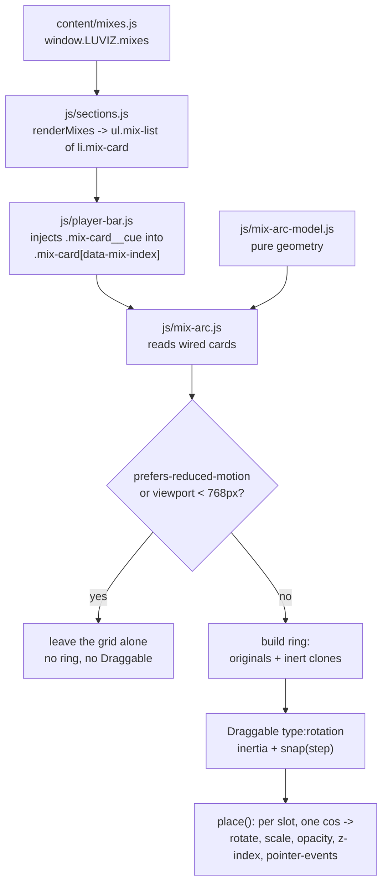

# The Mixes Arc Carousel - Plan

## Goal Capsule

**Objective.** Replace the mixes grid with the product-display mode codapress.co.uk uses for **Books by Codapress**: a full-bleed, shallow-arc carousel of cards hanging off a very large circle, dragged by rotation with inertia, snapped to a fixed angular step, with cards culled by depth and the list cycled by clones so the wheel never runs out.

**Authority hierarchy.** Requirements (R-IDs) win on product behaviour. Key Decisions (KD-IDs) carry the settled scope calls. Key Technical Decisions (KTD-IDs) win on implementation mechanism within their cited R constraints. Units override neither.

**Execution profile.** Zero-build static site. No package manager, no bundler, no install step. Classic `<script>` tags in fixed order; no modules, no `fetch()`. Agent verification is `node --test` from the repo root — never `node --test tests/`, which Node 24 rejects here with a phantom failure. Browser checks are listed separately and are owner-verifiable.

**Stop conditions.**

- **Stop if wiring the carousel appears to require editing `js/player-bar.js`.** KTD4 exists specifically so it does not. A change there means the clone-inertness contract was got wrong; re-read KTD4 rather than widening the diff.
- Stop if the full-bleed break-out puts a horizontal scrollbar on the page. R18 in the site plan forbids widening the document. Risk 2 gives the sanctioned technique.
- **Never press play on a mix embed.** Not while verifying, not to "check the player still works", not in a headless browser without `--mute-audio`. This has already played music through the owner's speakers once.
- Do not reproduce any code from codapress.co.uk. Measured numbers and mechanism descriptions are facts and may be used; their source is not to be copied. This continues the standing rule in `docs/solutions/conventions/codapress-motion-teardown.md`.

**Tail ownership.** The caller owns commit and handoff. This repo has **no git remote**, so shipping is local commits only: no push, no PR, no CI.

---

## Product Contract

### Summary

The mixes section currently prints a 1/2/3-column grid of square cards. The reference prints a **rotary arc**: cards sit as slots on a circle of ~2800px radius stepped 8° apart, so only a shallow crown of that circle is on screen. You drag it sideways, it coasts and snaps, cards tilt as they travel and fade out as they turn away. It reads as flicking through a rack of records rather than scanning a grid — which is why the owner named it as the correct display mode for a DJ's recorded sets.

The mechanism is already prototyped in this repo. `spike/motion-lab.html` carries a working rotary dial with Draggable rotation, inertia, derived angular step, clone-filled ring, cosine depth culling and keyboard parity. This plan graduates that prototype into the real mixes section against real content, the real player bar and the real scroll choreography.

### Problem Frame

`docs/solutions/conventions/codapress-motion-teardown.md` ranked the rotary drag dial third on its "worth taking" list and said explicitly: *"for the mixes rail rather than books. Solves U9's swipe rail and gives it a reason to exist beyond being a carousel."* The teardown also reframed what makes that site feel good — not scroll choreography, but *dense pointer-level micro-interaction*. `docs/HANDOFF.md` carries the owner's standing note that the motion work is under-delivered: *"It looks really good as it stands, but I think we can push it quite a lot further."* Restraint is the failure mode here.

Three things stand between the prototype and the section:

1. **The prototype's geometry was calibrated before the reference's real CSS was measured.** It guessed a radius of `max(760, vw*0.95)` and squashed the circle into an ellipse so cards stay upright. The reference uses a true circle at 2800px where cards *rotate with the ring*. That is a visible difference, not a detail.
2. **The player bar injects controls into `.mix-card[data-mix-index]`.** A ring padded with clones would either double-inject transports or hand the visitor dead play buttons.
3. **Two scroll scenes already own `transform` on the rail and its lead card**, and `.reveal--pending` owns `transform` and `opacity` on every card. The carousel writes inline `transform` and `opacity` on the same elements every frame. Whoever writes last wins, and it will flicker.

### What the reference display mode actually is

Read out of the served markup and its inline scoped stylesheet on 2026-08-05.

| Element | Measured |
| --- | --- |
| Shell | `width: 100vw; margin-left: calc(50% - 50vw)` — full-bleed out of the container, `padding-top: 3vh` |
| Geometry | `--arc-radius: 2800px`, `--arc-angle-step: 8deg`, `--arc-card-width: clamp(180px, 31.5vw, 270px)` |
| Viewport | `overflow: hidden`, `min-height: clamp(288px, 46.8vh, 504px)`, opacity 0 while `--layout-pending` |
| Ring | `position:absolute; left:50%; transform-origin: 50% var(--arc-radius); touch-action: pan-y pinch-zoom` |
| Slot | `position:absolute; height: var(--arc-radius); transform-origin: 50% var(--arc-radius); transform: rotate(var(--slot-angle))` |
| Card scale in arc | `--book-card-scale: .75` — type and padding shrink to 75% inside the carousel |
| Cursor | `grab`, `grabbing` while dragging; `data-cursor="drag"` on the region, `data-cursor="view"` on covers |
| Clones | marked `data-arc-clone`; focus styling applies only to `:not([data-arc-clone])` |
| Card anatomy, in order | tags row → cover → title → subtitle → "View detail" link |
| Cover | `aspect-ratio: 224 / 335`, 1px solid border, small radius, `overflow:hidden`, `object-fit: cover` |
| Type | title `text-sm` weight 700; subtitle `text-sm` line-height 1.2; link `text-sm` underlined |
| Region a11y | `role="region"`, `aria-roledescription="carousel"`, label naming drag, arrow keys and Escape |
| Section header | title + a right-hand action button (`label` + `→`) |

The slot's `transform-origin` sits at the circle's centre, so **a slot rotated by its angle also tilts by that angle**. At an 8° step, the third card out is tilted 24°. That fan is the signature of the display mode.

### Requirements

- **R1.** The mixes section presents mixes as a single full-bleed horizontal arc, not a grid.
- **R2.** The arc is dragged by pointer — mouse, pen and touch on one code path — coasts on release, and snaps to the angular step.
- **R3.** Cards tilt with the arc. A card's angular position sets its rotation, its scale, its opacity, its stacking order and whether it can be clicked.
- **R4.** The ring is continuous: the mix list is cycled into clones until the circle closes, so no gap ever shows.
- **R5.** Clones are inert. They are never announced to a screen reader, never focusable, never carry a mix index, and never receive a player control.
- **R6.** Every real mix remains reachable and operable without a pointer: arrow keys, Home and End walk the owner's list, not the padding.
- **R7.** The player bar keeps working exactly as it does now — a card's cover and title remain the play targets, and `data-mix-index` still identifies the mix.
- **R8.** A vertical page scroll survives a horizontal drag. The carousel is never a scroll trap on a phone.
- **R9.** A click and a drag are distinguishable. Ending a drag over a link or a play button does not trigger it.
- **R10.** Under `prefers-reduced-motion: reduce`, the arc is never constructed. The section falls back to the existing static grid.
- **R11.** With JavaScript off or broken, the section still prints something honest. The existing `<noscript>` note and the ship-visible reveal contract are preserved.
- **R12.** The carousel never widens the document or puts a horizontal scrollbar on the page.
- **R13.** The card shows, in the reference's order: a tags row, a cover, a title, a credit line, and an action link.
- **R14.** Cover art keeps the generated-artwork fallback for mixes with no `artwork` file.
- **R15.** Resizing the viewport re-derives the geometry rather than stretching a stale ring.

---

## Key Decisions

**KD1. The Codapress books display mode is the presentation model for the mixes section, copied as closely as the medium allows.** *(session-settled: user-directed — chosen over keeping the current grid or designing a novel display: the owner has already evaluated that display and named it the exact correct mode for their mixes.)* Governs R1, R2, R3, R4, R13.

**KD2. Where the medium diverges, the medium wins and the divergence is recorded.** Books are static portrait covers linking to a detail page. Mixes are square-cover audio with a player bar and no detail page. The three divergences that follow from that — cover ratio (KTD3), a play control instead of a detail link, which is what makes clone inertness load-bearing (KTD4), and list semantics (KTD8) — are fixed there rather than left to the implementer.

**KD3. This replaces the grid at desktop and tablet widths only; the grid remains the reduced-motion and narrow-viewport fallback.** An arc of ~270px cards is not a phone layout, and the reference itself keeps a much simpler presentation there. Governs R10.

---

## Key Technical Decisions

**KTD1. Graduate the motion-lab dial, but re-calibrate its geometry to the measured reference.** Take the prototype's derivation machinery — solve the step from card width and radius, round it so a whole number of slots closes the circle, rebuild on debounced resize — and drop its `DROOP_RATIO` ellipse. *Rejected: shipping the prototype's constants as-is.* The prototype was written against the teardown's "12°" summary before the real stylesheet was read; the measured values are 2800px and 8°, a far shallower and wider arc. The prototype's own comment already identifies shallow-step-over-large-radius as "the whole difference". Governs R1, R3, R15.

**KTD2. Cards rotate with the ring; they do not stay upright.** Slots take `transform-origin` at the circle centre and rotate by their own angle, matching the reference's slot rule. *Rejected: the prototype's upright-card ellipse.* Upright cards over a squashed circle read as a fan of playing cards; the reference's tilt reads as records leaning in a rack, which is also the section's own art direction. Governs R3.

**KTD3. Covers stay square. The 224/335 portrait ratio is not adopted.** *Rejected: cropping to portrait for fidelity.* Mixcloud artwork is square, `js/mix-art.js` generates square covers, and `assets/mixes/*.jpg` are square on disk. Forcing 2:3 would crop every existing cover and break the generated fallback. This is the largest deliberate divergence from verbatim. Governs R13, R14.

**KTD4. Clones are built from the boot sequence, after `LUVIZ.playerBar.init()` has wired the originals, and are stripped of every interactive hook.** The arc exposes `LUVIZ.mixArc.init()` and `js/app.js` calls it from `boot()` immediately after the player-bar line, using the same `optional(...)` guard. It clones the already-wired cards, then removes `data-mix-index`, sets `data-arc-clone` and `aria-hidden="true"`, sets `tabindex="-1"` on every focusable descendant, and applies `pointer-events: none`. Player-bar's `document.querySelectorAll('.mix-card[data-mix-index]')` then skips clones for free, so `js/player-bar.js` needs no edit at all — which is why editing it is a stop condition. Governs R4, R5, R7.

*Rejected: ordering `js/mix-arc.js` after `js/player-bar.js` in `index.html`.* **Script order does not sequence this, and assuming it does silently produces clones with no play button.** `js/player-bar.js` wires nothing at parse time — it only publishes `LUVIZ.playerBar = { init, … }`. The actual wiring happens when `js/app.js` `boot()` calls `optional('the player bar', LUVIZ.playerBar, 'init', [LUVIZ.mixes])` at line ~400, after `renderEverything()` at line ~384, and `boot()` itself waits for `DOMContentLoaded`. A module placed later in the script order still runs its top-level code long before any of that. The boot hook is the only ordering that actually holds.

*Rejected: excluding clones inside `js/player-bar.js`.* Stripping `data-mix-index` achieves the same thing without touching that file. Note that `claimCard` already guards on `data-cue === 'true'`, so a clone taken after wiring would be skipped even if its index survived — belt and braces, not a substitute for the strip.

**KTD5. The reveal and the entry scene move off the card and onto the shell.** `js/sections.js` stops putting `reveal` on `.mix-card`; the shell carries it instead. `mix-rail-lead` is retired from the scene plan and `mix-rail-entry` retargets to the shell. *Rejected: leaving the scenes pointed at the rail and its lead card.* `css/base.css` gives `.reveal--pending` both `transform` and `opacity`, and `mix-rail-lead` tweens `scale` on the first card — all three are clobbered every frame by the inline `transform`/`opacity` the placement loop writes, so the reveal would silently never play and the lead overshoot would flicker. This is the same class of defect as `docs/solutions/interaction/a-state-flag-on-body-matched-a-behaviour-selector.md`: two owners, one property, no error. Governs R3, R11.

**KTD6. Geometry is a pure module, tested under `node --test`.** Step derivation, slot count, wrap indexing and the cosine→depth mapping go in `js/mix-arc-model.js` with no DOM access; the DOM driver is `js/mix-arc.js`. *Rejected: one file.* This mirrors the split the repo already uses for `js/scene-plan.js`, `js/player-state.js` and `js/events-model.js`, and it is the only way the geometry gets test coverage on a site with no browser test runner.

**KTD7. Drag and click are disambiguated by Draggable's own `minimumMovement` plus a post-drag click guard.** *Rejected: relying on `dragClickables` alone.* The teardown records this as the bug everyone ships in a draggable carousel and notes the reference fixed it properly with a capture-phase blocker held for ~150ms after a drag ends. Governs R9.

**KTD8. The `<li>` becomes the slot and the card becomes an `<article>` inside it.** `mixCard` returns `<li class="mix-arc__slot"><article class="mix-card" data-mix-index="N">…</article></li>`. *Rejected: wrapping each card in a slot element, as the reference does.* The reference's slots sit in a plain `<div>` ring; ours sit in `<ul class="mix-list">`, and a `<div>` child of a `<ul>` is invalid markup. Rejected also: making the `<li>` itself both slot and card — the slot is `position:absolute` and `var(--arc-radius)` tall, so `player-bar`'s `card.appendChild(holder)` would drop the play button ~2800px below the artwork.

Splitting them keeps every dependent working unchanged: `player-bar` still finds `.mix-card[data-mix-index]` and still appends the transport inside the card's own box; the slot carries the positioning; the `<ul>`/`<li>` contract holds; and in the grid fallback the slot is an ordinary grid item wrapping the card. Governs R1, R3, R7, R13.

---

## Scope Boundaries

### In scope

The mixes section's presentation, its geometry module and tests, the two scene-plan entries that collide with it, and the section's stylesheet block.

### Deferred to Follow-Up Work

- **The custom cursor with its `DRAG` / `VIEW` label.** The reference drives this from `data-cursor` attributes read by a global cursor layer. That layer is U9 and does not exist. This plan ships a visible textual hint instead and leaves the `data-cursor` attributes in place for U9 to pick up.
- **Lenis smooth wheel.** Ranked first in the teardown, unrelated to this section, and needs its own decision.
- **Applying the arc to the crew list or the influences wall.**

### Outside this product's identity

- Adopting the reference's grid, type, colour or art direction. Only the display *mode* transfers. Ours stays Paradise Garage, Bankhead and H5.
- A "View detail" page per mix. There are no mix detail pages; the action link goes to the provider, as it does today.

---

## Assumptions

Recorded rather than asked, because this ran headless in a pipeline.

- **A1.** The arc replaces the grid at ≥768px and the grid persists below that (KD3). If the owner wants the arc on phones too, that is a one-breakpoint change, not a re-plan.
- **A2.** "Bestseller / New" badges map to the chips the card already carries — the provider name and, when a beat grid exists, the BPM. No new taxonomy is invented for mixes.
- **A3.** The section header keeps its existing eyebrow / title / note structure rather than adopting the reference's right-hand `All Books →` action button, since there is no "all mixes" page to link to.

---

## High-Level Technical Design

Directional guidance for review, not implementation specification.



The whole placement loop is one number per slot per frame. `cos(slotAngle + ringRotation)` yields depth; every visual decision is a function of that depth.

```
step        = round-to-close-the-circle( asin( cardWidth * gap / radius ) )
slotCount   = 360 / step
depth(i)    = cos( (i * step + ringRotation) * pi/180 )
rotate(i)   = i * step + ringRotation        // the card tilts with the arc
scale(i)    = min + (max - min) * (depth+1)/2
opacity(i)  = depth > 0 ? ramp(depth) : 0
zIndex(i)   = round( (depth+1) * 100 )
clickable(i)= depth >= 0.35
```

---

## Implementation Units

### U1. The geometry module and its tests

**Goal.** A pure, tested model of the arc: derive the step, close the circle, map a slot index to its depth and its five visual outputs, and wrap the keyboard index onto the real mixes.

**Requirements.** R1, R3, R4, R6, R15. Implements KTD1, KTD6.

**Dependencies.** None.

**Files.**
- create `js/mix-arc-model.js`
- create `tests/mixarc.test.js`

**Approach.**
1. Export a `geometry(viewportWidth)` returning `{ cardWidth, radius, step, slotCount }`. Card width follows the reference's `clamp(180px, 31.5vw, 270px)`. Radius targets the measured 2800px at desktop widths rather than the prototype's `vw*0.95` — roughly `clamp(1600, vw * 1.9, 3200)`, which lands on ~2740px at 1440. Treat those three numbers as the starting calibration, not a settled answer: the test asserts the *relationships* (step shrinks as radius grows, the circle closes exactly), so the constants can be tuned against the browser without going red.
2. Solve the step from card width, radius and a gap factor, then round `slotCount` to an integer and recompute `step = 360 / slotCount` so the ring closes exactly and wraps seamlessly.
3. Export a `place(index, step, spin)` returning `{ depth, rotate, scale, opacity, zIndex, clickable }` — no DOM, no units.
4. Export `wrap(index, realCount)` for keyboard travel over the owner's list rather than the padded slot count.
5. Follow the file shape of `js/scene-plan.js`: an IIFE writing onto `window.LUVIZ`, with the `module.exports` tail the existing tests rely on.

**Patterns to follow.** `js/scene-plan.js` and `js/player-state.js` for the pure-module shape and namespace tail; `tests/sceneplan.test.js` for test structure.

**Test scenarios.**
- A derived `slotCount` always divides 360 into an integer number of steps, checked across viewport widths from 320 to 2560.
- `step` shrinks as the viewport widens (a bigger radius means a shallower step), and never exceeds a sane ceiling.
- `cardWidth` clamps at 180 for a 320px viewport and at 270 for a 2560px viewport.
- `place(0, step, 0)` returns `depth === 1`, maximum scale, full opacity, highest z-index, `clickable: true`.
- A slot half a turn away returns `depth` ≤ 0, `opacity: 0` and `clickable: false`.
- `rotate` for slot *i* equals `i * step + spin`, confirming the card tilts with the ring rather than staying upright (KTD2).
- `zIndex` is a non-negative integer for every slot at every spin.
- `clickable` is false for a depth just under 0.35 and true just over it.
- `wrap(-1, 10)` is 9 and `wrap(10, 10)` is 0 — arrow keys walk the real list, not the clones.
- `geometry()` with a zero or negative width returns the narrow-viewport floor rather than `NaN` or a divide-by-zero.

**Verification.** `node --test` from the repo root passes with the new file included.

---

### U2. Detach the card from the reveal and the entry scene

**Goal.** Free `transform` and `opacity` on `.mix-card` so exactly one owner writes them, before anything starts writing them every frame.

**Requirements.** R3, R11. Implements KTD5.

**Dependencies.** None. Land before U4.

**Files.**
- modify `js/sections.js` (drop `reveal` from the `.mix-card` class list; add the shell wrapper)
- modify `index.html` (the `#mixes` section markup)
- modify `js/scene-plan.js` (selectors, scene definitions, resting-state registry)
- modify `js/scenes.js` (`mix-rail-entry` retarget, `mix-rail-lead` removal)
- modify `tests/sceneplan.test.js`

**Approach.**
1. In `index.html`, wrap `<ul class="mix-list" id="mix-list">` in a shell and viewport: `<div class="mix-arc reveal" data-mix-arc><div class="mix-arc__viewport">…</ul></div></div>`. The `reveal` class moves here.

   **The wrapper ships inert.** It is in the markup unconditionally, including when the arc never builds (reduced motion, narrow viewport, GSAP missing). So `.mix-arc` and `.mix-arc__viewport` must carry no `overflow`, no `min-height`, no `position` and no full-bleed of their own — every one of those rules is scoped under `[data-arc-state="live"]` in U6. An unconditional `overflow: hidden` here silently clips the grid fallback, and an unconditional `min-height` leaves a dead band under it.
2. In `js/sections.js`, `mixCard` creates `el('li', 'mix-card')` — no `reveal`.
3. In `js/scene-plan.js`, repoint the `mix-rail` selector at `.mix-arc`, delete the `mix-rail-lead` selector, its `write()` entry and its resting-state entry.
4. In `js/scenes.js`, `mix-rail-entry` tweens `x` on the shell only; delete the lead-card overshoot branch.
5. Leave `mix-active-art` alone — it writes `scale` on `.mix-card__figure`, a different element from the slot, so it does not collide.

**Execution note.** Update `tests/sceneplan.test.js` first and watch it fail on the removed `mix-rail-lead` entry before touching the plan file. The scene plan has a write-ownership registry and a resting-state list that must stay in step with each other; a red test naming the missing entry is the cheapest proof they did.

**Patterns to follow.** The existing `write()` / resting-state pairing in `js/scene-plan.js` lines ~470-515.

**Test scenarios.**
- No two scenes declare a write on the same property of the same element (the existing ownership assertion, re-run).
- Every element named in a `write()` has a matching resting-state entry, and vice versa — `mix-rail-lead` appears in neither.
- The resting state for `mix-rail` is `{ x: 0 }` on the shell.
- `mix-active-art` still writes `scale` and is untouched.
- The mixes section still resolves a scene for the `mixes` section id.

**Verification.** `node --test` passes. In a browser, the mixes section still slides in on scroll and the cards are visible on load with JavaScript disabled.

---

### U3. Rebuild the card to the reference's anatomy

**Goal.** The card prints tags, cover, title, credit and action link in the reference's order, at the reference's hierarchy, with the square-cover divergence applied.

**Requirements.** R13, R14, R7. Implements KTD3, KTD8.

**Dependencies.** U2.

**Files.**
- modify `js/sections.js` (`mixCard`)
- modify `css/sections.css` (the MIXES block)
- modify `tests/content.test.js`

**Approach.**
1. Restructure `mixCard` per KTD8: it now returns `<li class="mix-arc__slot">` wrapping `<article class="mix-card" data-mix-index="N">`. `data-mix-index` and `data-provider` move onto the `<article>`, not the `<li>` — `player-bar` reads them off `.mix-card`.
2. Reorder the card's children so the chips row is emitted **before** the figure, matching the reference's tags-above-cover order. Today the figure comes first.
3. Keep `mediaFigure(mix.artwork, mix.title, …)` and its `media--square` class untouched so the `js/mix-art.js` generated fallback keeps working (R14, KTD3).
4. Give the cover surface the reference's treatment: hairline border, small radius, `overflow: hidden`, `object-fit: cover`.
5. Keep the existing `.link-row` action anchor — the provider link the player bar's credit handling depends on (R7).
6. Add `data-cursor="drag"` on the region and `data-cursor="view"` on covers now, inert until U9 builds the cursor layer.
7. Apply an in-arc type scale (the reference uses 0.75) via a CSS custom property on the shell so the card shrinks only inside the carousel and the fallback grid keeps full-size type.

**Test scenarios.**
- Every `<li class="mix-arc__slot">` contains exactly one `.mix-card`, and `#mix-list` contains only `<li>` children (KTD8).
- `data-mix-index` resolves on the `.mix-card` article, not the `<li>` — the selector `.mix-card[data-mix-index]` matches once per mix.
- Every rendered card contains, in DOM order: chips row, figure, title, credit, link row.
- A mix with no `artwork` still renders a figure carrying a generated cover, not a broken image.
- A mix with no `credit` renders without an empty credit paragraph.
- A mix with a beat grid renders a BPM chip; one without renders only the provider chip.
- `data-mix-index` is present and sequential on every card.
- The existing content drift guard between `content/site.js` and `index.html` still passes.

**Verification.** `node --test` passes. In a browser, the grid fallback renders correctly at narrow widths with covers square and uncropped.

---

### U4. The arc driver

**Goal.** Build the ring, place the slots every frame, and drag it with inertia and snap.

**Requirements.** R1, R2, R3, R4, R8, R9, R15. Implements KTD1, KTD2, KTD7.

**Dependencies.** U1, U2, U3.

**Files.**
- create `js/mix-arc.js`
- modify `index.html` (one `<script>` tag)
- modify `js/app.js` (one `optional(...)` line in `boot()`)
- modify `css/sections.css`

**Approach.**
1. Publish `LUVIZ.mixArc = { init: … }` and have `js/app.js` `boot()` call it via `optional('the mixes arc', LUVIZ.mixArc, 'init', [])` on the line **after** the existing player-bar call. Add the `<script src="js/mix-arc.js">` tag after `js/player-bar.js` for readability, but do not rely on tag order for sequencing — see KTD4.
2. Read the `li.mix-arc__slot` elements out of `#mix-list` (U3 already emits that structure), position them as slots, and pad with clones (U5) until `slotCount` is reached.
3. Hold the viewport at `opacity: 0` with a `--layout-pending` state class until the first measure-and-place completes, then reveal — the reference does this and it is what stops a flash of stacked cards.
4. `Draggable.create(ring, { type: 'rotation', inertia: !!window.InertiaPlugin, allowNativeTouchScrolling: true, snap: gsap.utils.snap(step), … })`, with `touch-action: pan-y pinch-zoom` on the ring (R8).
5. `place()` runs on `onDrag`, `onThrowUpdate`, `onThrowComplete` and `onDragEnd`, writing `transform`, `opacity`, `zIndex` and `pointerEvents` per slot from `LUVIZ.mixArc.place()`.
6. Click-vs-drag (R9, KTD7): set `minimumMovement`, and add a capture-phase click blocker armed on drag start and released ~150ms after the throw settles.
7. Cursor state: `grab` on the ready region, `grabbing` while dragging.
8. Debounced resize re-derives geometry and rebuilds the ring, since `slotCount` itself depends on the viewport (R15).
9. Guard the whole module: if `gsap` or `Draggable` is missing, return without touching the DOM and leave the grid standing.

**Execution note.** Verify in a real browser at more than one width before wiring the keyboard. The single most likely defect is a viewport height that leaves a dead band under the arc or clips the lowest card — the prototype hit exactly this and fixed it by measuring a real card's height rather than guessing.

**Patterns to follow.** `spike/motion-lab.html` lines ~439-600 for the ring/place/Draggable shape; `js/influences.js` `gestures()` for the repo's established Draggable registration, plugin-absence guard and `allowNativeTouchScrolling` handling.

**Test scenarios.** Geometry is covered by U1. This unit is DOM-bound, so its proof is browser observation:
- With 10 mixes the ring renders `slotCount` slots and no visible gap at any rotation.
- Dragging horizontally over the arc on a touch device still scrolls the page vertically.
- Releasing a drag settles on a step boundary, not between two cards.
- A card at the front is clickable; a card turned past the cull threshold is not.
- Pressing and releasing on a card without moving follows its link; dragging and releasing over the same card does not.
- No horizontal scrollbar appears at any width from 320 to 2560 (R12).
- With `Draggable` blocked, the section still prints every mix.

**Verification.** Browser check at 768, 1280 and 1920 with `--mute-audio`. `node --test` still passes.

---

### U5. Inert clones and the accessibility contract

**Goal.** Pad the ring without lying to assistive technology, stealing focus, or handing out dead play buttons.

**Requirements.** R4, R5, R6, R7. Implements KTD4.

**Dependencies.** U4.

**Files.**
- modify `js/mix-arc.js`
- modify `css/sections.css`

**Approach.**
1. Clone from the already-wired originals (per the boot hook established in U4 step 1 and KTD4), then strip: remove `data-mix-index`, set `data-arc-clone="true"`, set `aria-hidden="true"`, set `tabindex="-1"` on every focusable descendant, and apply `pointer-events: none` via the `[data-arc-clone]` attribute.
2. Give the region `role="region"`, `aria-roledescription="carousel"` and a label naming the drag and the arrow keys, as the reference does.
3. Keyboard travel (R6): arrow keys, Home and End rotate the ring, wrapping via `LUVIZ.mixArc.wrap()` over the **real** mix count. A `focusin` handler rotates whatever just received focus to the front, so tabbing never leaves focus on an invisible card.
4. Under reduced motion the keyboard rotation jumps instead of tweening.
5. Restrict focus-visible styling to `:not([data-arc-clone])`.

**Test scenarios.**
- The number of elements matching `.mix-card[data-mix-index]` equals the number of real mixes, no matter how many clones the ring holds — this is the assertion that proves the player bar cannot double-inject.
- Every `[data-arc-clone]` carries `aria-hidden="true"` and holds no element with a non-negative `tabindex`.
- Tabbing forward through the section visits each real mix exactly once and never a clone.
- Arrow-key travel from the first card backwards lands on the last real mix, not on a clone.
- `focusin` on a card off to one side brings it to the front.
- A clone renders the play button visually but the button is not reachable and does not fire.

**Verification.** Keyboard walk of the whole section in a browser. Confirm `document.querySelectorAll('.mix-card[data-mix-index]').length` equals `window.LUVIZ.mixes.length` in the console. **Do not click a play button to verify it works** — assert the listener's presence, not its effect.

---

### U6. Full-bleed shell, reduced-motion fallback and narrow-viewport fallback

**Goal.** Break the arc out of the container without widening the document, and make sure the thing it degrades to is the grid that already works.

**Requirements.** R10, R11, R12, KD3.

**Dependencies.** U4, U5.

**Files.**
- modify `css/sections.css`
- modify `js/mix-arc.js`

**Approach.**
1. Full-bleed the shell out of `.section__inner`. **Do not use `width: 100vw`** — see Risk 2. Use a margin break-out with `overflow-x: clip` on the section so the break-out cannot widen the document (R12).
2. Set the viewport's `min-height` from the arc's own droop plus a measured card height, not a guess.
3. Gate construction in `js/mix-arc.js`: if `matchMedia('(prefers-reduced-motion: reduce)').matches`, or the viewport is below the grid breakpoint, return before building the ring. The untouched `ul.mix-list` is then styled by the existing grid rules (R10, KD3).
4. Keep the grid rules in `css/sections.css` intact and scope the arc rules under `[data-arc-state="live"]`, set on the shell by the driver only after a successful build, so the stylesheet alone never hides anything (the ship-visible contract in `css/base.css`). The intermediate value is `[data-arc-state="pending"]`, which is what holds the viewport at `opacity: 0` in U4 step 3.

**Naming constraint (do not collapse these).** Three distinct attributes are in play and each does exactly one job: `data-mix-arc` marks *which element* is the shell, `data-arc-state` carries *what mode* the arc is in, and `data-arc-clone` marks *which slots* are padding. They must not be merged or given overlapping names. A state flag and a behaviour marker sharing an attribute name is precisely the defect recorded in `docs/solutions/interaction/a-state-flag-on-body-matched-a-behaviour-selector.md`, where a container silently matched its own behaviour selector and destroyed the page with no error.

**Test scenarios.**
- With reduced motion on, no ring is built, no inline transforms are written, and every mix prints in the grid.
- With reduced motion on, the section has no `grab` cursor and no drag affordance text.
- At 375px the grid renders one column; at 768px the arc is active.
- `document.documentElement.scrollWidth` does not exceed `clientWidth` at any tested width (R12).
- Toggling reduced motion and reloading switches presentation cleanly with no orphaned inline styles.
- With JavaScript disabled the `<noscript>` note prints and no empty container is left behind (R11).

**Verification.** Browser check with reduced motion forced on and off, at 375, 768 and 1440. `node --test` passes.

---

## Verification Contract

**Automated, run by the implementer.**

```
node --test          # from the repo root. NOT `node --test tests/`
```

Gates: all existing tests pass, plus `tests/mixarc.test.js` and the updated `tests/sceneplan.test.js` and `tests/content.test.js`.

**Browser, `--mute-audio` mandatory.**

| Check | Where |
| --- | --- |
| Arc renders, drags, coasts, snaps | 768 / 1280 / 1920 |
| No horizontal scrollbar | 320 → 2560 |
| Vertical scroll survives horizontal drag | touch emulation |
| Click vs drag disambiguation | any width |
| Keyboard walks real mixes only | 1280 |
| Grid fallback under reduced motion | 1280, reduced motion forced |
| Grid fallback at narrow width | 375 |
| Generated cover art still appears | mixes without `artwork` |

**Standing prohibition.** No agent presses play on a mix embed at any point in verification. Assert wiring, not playback.

---

## Definition of Done

- All six units landed, `node --test` green from the repo root.
- The arc initialises from `js/app.js` `boot()` after the player-bar line, not from script-tag order.
- `#mix-list` contains only `<li>` children and every `.mix-card` is an `<article>` inside one.
- The mixes section presents a full-bleed dragged arc at ≥768px with cards tilting, culling and snapping.
- The player bar's play controls still appear on every real mix and on no clone.
- The scene plan's write-ownership and resting-state registries are consistent and `mix-rail-lead` is gone from both.
- Reduced motion and narrow viewports fall back to the existing grid with no orphaned inline styles.
- No horizontal scrollbar at any tested width.
- No code from codapress.co.uk is present in the repo.

---

## Risks & Dependencies

**Risk 1 — clones are built before the player bar has wired the originals, so they render with no play button.** The trap is that this *looks* like a script-order problem and is not: `js/player-bar.js` publishes `init` at parse time and does its wiring only when `js/app.js` `boot()` calls it after `DOMContentLoaded`. *Mitigation:* KTD4's boot-sequence hook in `js/app.js`, plus U5's assertion that `.mix-card[data-mix-index]` count equals the real mix count. That assertion is the single one most worth writing first.

**Risk 1b — the arc reads the card list before `sections.mixes()` has rendered it, and silently builds an empty ring.** `renderMixes` also calls `clear(list)`, so any later re-render would destroy a ring already built over those cards. *Mitigation:* the same boot hook — `renderEverything()` runs at `js/app.js:~384`, well before the arc's init line — and the arc returns without building when `#mix-list` holds no cards, leaving the grid standing.

**Risk 2 — `width: 100vw` puts a horizontal scrollbar on the page.** `100vw` includes the vertical scrollbar's width, so the reference's own break-out technique would violate R12 here. *Mitigation:* margin break-out plus `overflow-x: clip` on the section, verified by comparing `scrollWidth` to `clientWidth` rather than by eye.

**Risk 3 — the arc's viewport height is wrong and leaves a dead band or clips the bottom card.** The prototype hit this exactly, and its comment records that guessing the card height was the cause. *Mitigation:* measure a real rendered card, as U4 step 3 and U6 step 2 require.

**Risk 4 — `place()` fights a scene or the reveal for `transform`.** No error is thrown; it just flickers or silently never animates. *Mitigation:* U2 lands first and removes both other owners. This failure mode has a documented precedent in this repo (`docs/solutions/interaction/`).

**Risk 5 — InertiaPlugin unavailable at runtime.** It is CDN-loaded and unpinned by SRI. *Mitigation:* `inertia: !!window.InertiaPlugin`, the same guard `js/influences.js` already uses; the arc drags without coasting rather than failing.

**Dependency.** GSAP 3.15.0 with Draggable and InertiaPlugin — already loaded in `index.html`, same version as the reference. Nothing new to add.

---

## Sources & Research

- `docs/solutions/conventions/codapress-motion-teardown.md` — the prior teardown; ranked the rotary dial third and named the mixes rail as its target.
- `spike/motion-lab.html` lines ~439-600 — the working prototype this graduates.
- `docs/plans/2026-08-05-002-feat-tile-hover-spike-plan.md` — sibling plan; its R17 confines the tile-hover work to the spike, which is why this plan owns the `js/`, `css/` and `content/` changes.
- `docs/solutions/interaction/a-state-flag-on-body-matched-a-behaviour-selector.md` — the two-owners-one-property failure class behind KTD5 and Risk 4.
- `https://codapress.co.uk` — served markup and inline scoped stylesheet, read 2026-08-05. Measurements are recorded in "What the reference display mode actually is"; no source is reproduced.
- `js/influences.js` `gestures()` — the repo's established Draggable + Inertia registration and guard pattern.
